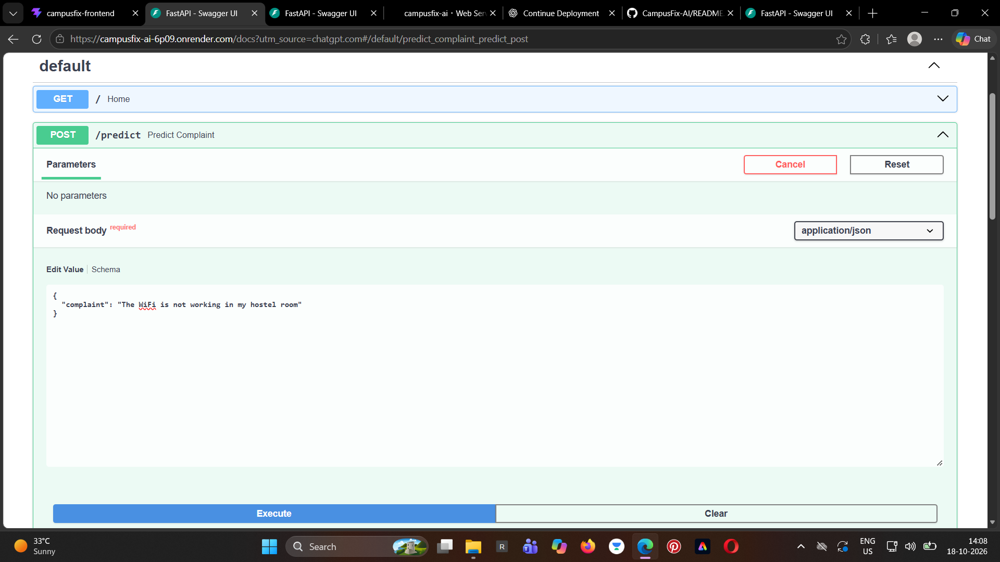
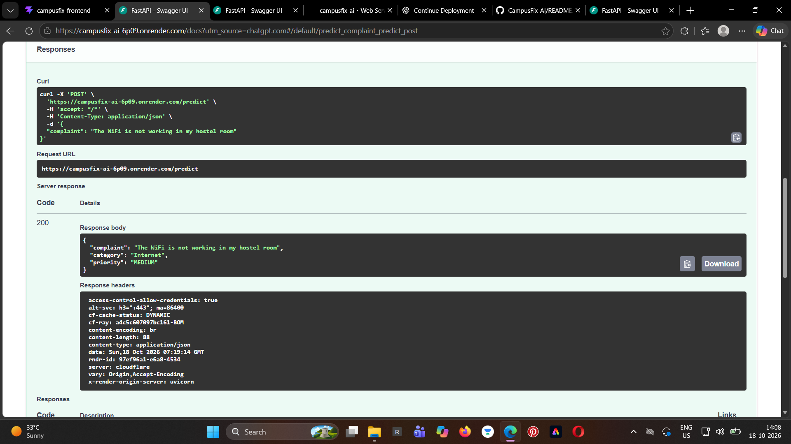

# CampusFix AI - Smart Campus Complaint Management System


CampusFix AI is a web-based complaint management system that helps students report campus issues and track their resolution. It uses machine learning to predict complaint categories and priorities.

## Live Demo

- **Live Application (Frontend):** https://campus-fix-ai-iota.vercel.app
- **Backend API (Complaints):** https://campusfix-backend-gxmz.onrender.com/api/complaints
- **AI Service Documentation (FastAPI):** https://campusfix-ai-6p09.onrender.com/docs
## Dashboard Preview

.png>)

## AI Prediction Example

CampusFix AI uses a machine learning model to classify student complaints and predict their priority.

**Request Body**



**AI Response**



## Deployment

- **Frontend (Vercel):** https://campus-fix-ai-iota.vercel.app/
- **Backend (Render):** https://campusfix-backend-gxmz.onrender.com/api/complaints
- **AI Service (Render):** https://campusfix-ai-6p09.onrender.com/docs
- **Database (Neon PostgreSQL):** Managed PostgreSQL database

## Features


- **Complaint Submission:** Submit campus complaints through a React interface.

- **AI-Powered Classification:** Predict complaint categories using TF-IDF and Logistic Regression.

- **Priority Prediction:** Predict complaint priority using the AI service.

- **Complaint Tracking:** View complaints and their current status.

- **Status Management:** Update complaints to OPEN, IN-PROGRESS, or RESOLVED.

- **Database Integration:** Store complaint records in PostgreSQL through Spring Boot.

- **REST APIs:** Communicate between services using REST endpoints.


## Technology Stack

- **Frontend:** React, Vite, JavaScript, CSS
- **Backend:** Java, Spring Boot
- **AI Service:** Python, FastAPI, scikit-learn
- **Machine Learning:** TF-IDF, Logistic Regression
- **Database:** PostgreSQL
- **API Testing:** Swagger UI, Postman
- **Version Control:** Git, GitHub

## System Architecture

CampusFix AI uses a service-based architecture connecting the frontend, backend, database, and machine learning service.

1. **Frontend:** The React application allows users to submit complaints and view complaint records and statuses.
2. **Backend:** The Spring Boot REST API receives requests and manages complaint operations.
3. **AI Service:** The backend sends complaint text to the FastAPI service, which predicts the complaint category and priority using the machine learning pipeline.
4. **Database:** PostgreSQL stores complaint details and status information.
5. **Response:** The backend returns the relevant complaint data to the frontend, where users can view the results and updated statuses.

### Architecture Flow

```text
User
  |
  v
React Frontend (Vercel)
  |
  v
Spring Boot REST API (Render)
  |                 |
  v                 v
PostgreSQL       FastAPI AI Service (Render)
(Neon)                |
                      v
              TF-IDF + Logistic Regression
                      |
                      v
              Predicted Category & Priority
```


## Project Structure

```text
CampusFix/
|-- campusfix-frontend/   - React frontend
|-- campusfix-backend/    - Spring Boot REST API
|-- ai-sevice/            - FastAPI machine learning service
```


## Running Locally


### Prerequisites


- Node.js and npm

- Java and Maven

- Python and pip

- PostgreSQL


### 1. Start the AI service


Open a terminal in the project root and run:


```powershell

cd ai-sevice

python -m uvicorn app:app --host 127.0.0.1 --port 8001

```


AI API documentation: http://127.0.0.1:8001/docs


### 2. Start the Spring Boot backend


Open a second terminal in the project root. Configure PostgreSQL and set the `DB_PASSWORD` environment variable first.


```powershell

cd campusfix-backend

.\\mvnw.cmd spring-boot:run

```


Backend base URL: http://localhost:8080


### 3. Start the React frontend


Open a third terminal in the project root:


```powershell

cd campusfix-frontend

npm install

npm run dev

```


Open the local URL shown by Vite, usually http://localhost:5173.

## API Endpoints

### Spring Boot Backend

**Base URL:** `https://campusfix-backend-gxmz.onrender.com`

| Method | Endpoint | Purpose |
|---|---|---|
| POST | `/api/complaints` | Submit a new complaint |
| GET | `/api/complaints` | Retrieve all complaints |
| GET | `/api/complaints/{id}` | Retrieve a complaint by ID |
| PUT | `/api/complaints/{id}/status?status=RESOLVED` | Update a complaint's status |
| DELETE | `/api/complaints/{id}` | Delete a complaint |

### FastAPI AI Service

**Base URL:** `https://campusfix-ai-6p09.onrender.com`

| Method | Endpoint | Purpose |
|---|---|---|
| POST | `/predict` | Predict complaint category and priority |

Interactive API documentation: https://campusfix-ai-6p09.onrender.com/docs

The Spring Boot backend communicates with the AI service to obtain predictions and manages complaint persistence through PostgreSQL.

## Security and Configuration

- External service URLs are configured using environment variables.
- Database credentials and sensitive configuration values should be kept out of version control.
- Cross-Origin Resource Sharing (CORS) is configured for frontend-backend communication.
- Separate configuration is maintained for local development and deployment.


## Future Improvements

- Student, administrator, and technician dashboards
- User authentication and role-based access control
- Email or in-app notifications
- Automated testing and improved error handling
- Complaint analytics and reporting dashboards
- Model evaluation using a larger, representative dataset


  
## Developer


**Vanshika Singh**  

Electrical Engineering Student | Aspiring Software Development Engineer


GitHub: https://github.com/vansie-S


---


*Built to make campus issue reporting and resolution more organized and accessible.*


